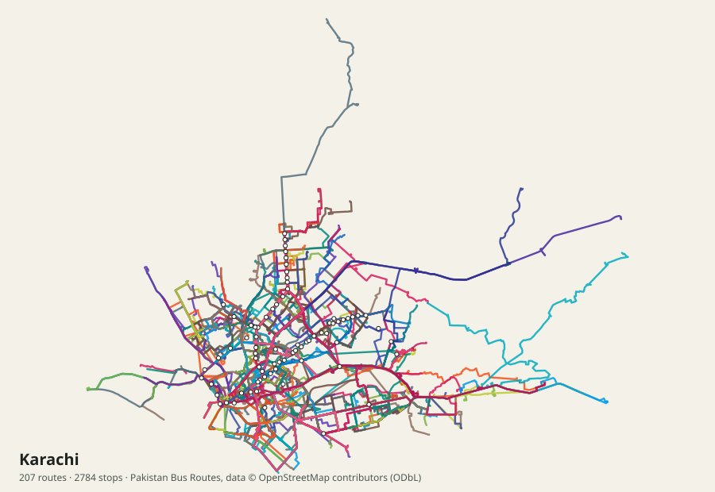
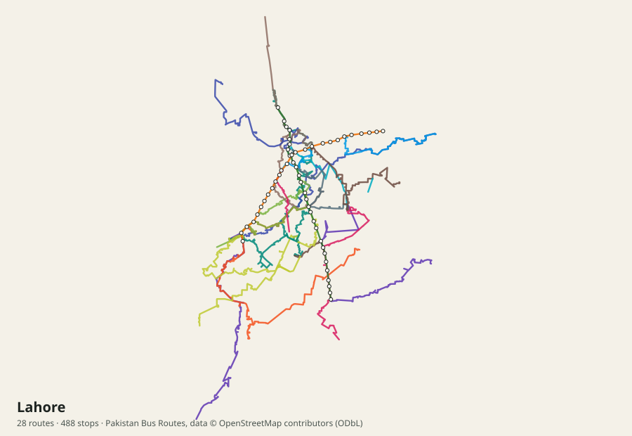
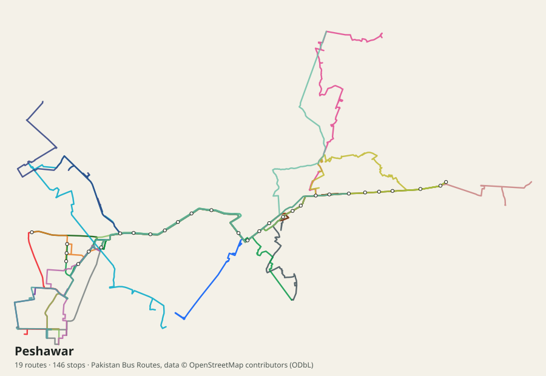

# Pakistan Bus Routes · پاکستان بس روٹس

An open-source map, route guide and trip planner for public buses, BRT and metro in Pakistan, with an open dataset anyone can reuse.

Pakistan has no official open transit data. There is no GTFS feed and no public API. Route information is scattered across government pages, news reports, social media posts and route-guide websites. This project collects it in one place, cites every source, matches stops to OpenStreetMap and publishes it as a web app, GeoJSON and GTFS.

**Live site:** `https://<your-github-username>.github.io/pakistan-bus-routes/` (after you enable GitHub Pages, see below)

> ⚠️ Community-compiled data. Routes, stops and fares change often. Confirm with the operator before you travel, and please [report mistakes](../../issues/new/choose).

## The networks, drawn from this data

| | |
|---|---|
|  |  |
|  |  |

Regenerate with `npm run preview:maps`.

## What is covered

See [docs/COVERAGE.md](docs/COVERAGE.md) for the per-route list, generated from the data.

| Region | Systems |
|---|---|
| Karachi | Peoples Bus Service Red Bus (R-series), EV electric buses, Pink women-only buses, Green Line and Orange Line BRT, plus Red/Yellow/Brown BRT and Karachi Circular Railway marked as under construction or planned |
| Lahore | Metrobus, Orange Line Metro Train, Speedo feeder routes, electric buses |
| Islamabad & Rawalpindi | Metrobus Red, Orange, Blue and Green lines, CDA electric feeder routes, Rawalpindi electric buses |
| Peshawar | Zu BRT (TransPeshawar) corridor and feeder routes |
| Multan | Metrobus, feeder and electric bus routes |
| Punjab districts | Green electric bus routes in more than 30 cities |
| Sindh | Peoples Bus Service in Hyderabad, Sukkur, Larkana, Nawabshah and Mirpurkhas |
| Quetta | Green Bus |

## Features

- **Trip planner.** Pick a stop, a place or a point on the map. It finds direct routes and journeys with up to two changes, including walking between stops, and estimates time and fare.
- **Route pages.** Every stop in order, interchanges, fare, hours, frequency, operator helpline, sources and a "report a mistake" button.
- **Stop pages.** All routes that serve a stop.
- **Nearby.** Stops around your current location.
- **English and Urdu,** with right-to-left layout, plus light and dark themes.
- **Works offline** after the first visit, as an installable Progressive Web App.
- **Open downloads.** GTFS zip, GeoJSON and CSV.

## Quick start

Requires Node.js 20 or newer.

```bash
npm install
npm run data:build   # compile data/systems -> public/data (offline)
npm run dev          # http://localhost:5173
```

Other commands:

| Command | What it does |
|---|---|
| `npm test` | Unit tests for the trip planner, fares and geometry |
| `npm run data:validate` | Check every file in `data/systems/` |
| `npm run data:osm` | Download named places from OpenStreetMap for each city (network) |
| `npm run data:geocode` | Fill missing stop coordinates from OpenStreetMap and Nominatim (network) |
| `npm run data:names` | Fill missing Urdu stop names from the OpenStreetMap cache |
| `npm run data:shapes` | Build road-following route lines with OSRM (network) |
| `npm run build` | Production build into `dist/` |

## How the data works

```
research/*.json ──import──▶ data/systems/<system>.json   ◀── humans edit these
                                   │
             data:osm + data:geocode (coordinates, marked "auto:")
                                   │
                            data:shapes (OSRM road lines)
                                   │
                      data:build ──▶ public/data/*.json  (app)
                                 ──▶ public/downloads/   (GTFS, GeoJSON, CSV)
                                 ──▶ docs/COVERAGE.md
```

- One file per transit system lives in [`data/systems/`](data/systems). The format is described in [docs/DATA_FORMAT.md](docs/DATA_FORMAT.md).
- Every stop coordinate carries a `coord_source`. Coordinates checked by a person use an OpenStreetMap id, `wikipedia` or `manual`. Automatic ones start with `auto:`, and the app shows interpolated stops as estimated.
- Times in the planner and GTFS are **estimates** from distance and typical speeds, because operators do not publish timetables.

## Contributing

Corrections from people who ride these buses are the most valuable contribution. You don't need to code:

1. Open an issue with the [route correction form](../../issues/new/choose), or
2. Edit the JSON file in `data/systems/` directly on GitHub and open a pull request.

Read [CONTRIBUTING.md](CONTRIBUTING.md) for details, including how to fix a stop location.

Some organisations hold better data that needs their permission. [docs/OUTREACH.md](docs/OUTREACH.md) lists who to ask and has ready-to-send emails and Right to Information requests. What was searched and what was found is in [research/sources-datasets.md](research/sources-datasets.md), [research/sources-official.md](research/sources-official.md) and [research/sources-apis.md](research/sources-apis.md).

## Deploying to GitHub Pages

1. Push this repository to GitHub.
2. In **Settings → Pages**, set the source to **GitHub Actions**.
3. The `Deploy` workflow builds the site on every push to `main` and publishes it at `https://<user>.github.io/<repo>/`.

## License

- **Code** is under the [MIT License](LICENSE).
- **Data** in `data/` and the published downloads is under the [Open Database License (ODbL) 1.0](DATA_LICENSE.md). It contains information from © OpenStreetMap contributors. Attribute "Pakistan Bus Routes contributors, © OpenStreetMap contributors".
- Facts were compiled from the public sources listed in each system file and in [docs/SOURCES.md](docs/SOURCES.md). This project is not affiliated with any transit authority.

---

## اردو

**پاکستان بس روٹس** ایک اوپن سورس ویب ایپ اور ڈیٹا سیٹ ہے جس میں پاکستان کے سرکاری بس، بی آر ٹی اور میٹرو روٹس، اسٹاپس، کرائے اور سفر پلانر شامل ہیں۔

پاکستان میں ٹرانسپورٹ کا کوئی سرکاری اوپن ڈیٹا موجود نہیں۔ یہ منصوبہ سرکاری ویب سائٹس، خبروں اور روٹ گائیڈز سے معلومات جمع کرتا ہے، ہر ذریعہ درج کرتا ہے، اور اسٹاپس کو اوپن اسٹریٹ میپ پر ملاتا ہے۔

- **سفر پلانر:** روانگی اور منزل منتخب کریں، ایپ براہ راست بس یا بس تبدیل کر کے جانے کا راستہ، وقت اور کرایہ بتاتی ہے۔
- **روٹ اور اسٹاپ کی تفصیل:** ہر اسٹاپ، کرایہ، اوقات اور ہیلپ لائن۔
- **قریبی اسٹاپس:** آپ کی لوکیشن کے قریب اسٹاپس۔
- **اردو اور انگریزی،** ڈارک موڈ، اور انٹرنیٹ کے بغیر بھی کام کرتی ہے۔

**غلطی نظر آئے؟** ایپ میں "غلطی رپورٹ کریں" بٹن دبائیں یا گٹ ہب پر issue کھولیں۔ روزانہ سفر کرنے والوں کی تصحیحات اس منصوبے کی سب سے بڑی طاقت ہیں۔

> یہ کمیونٹی کا جمع کردہ ڈیٹا ہے۔ سفر سے پہلے متعلقہ ادارے سے تصدیق کر لیں۔
